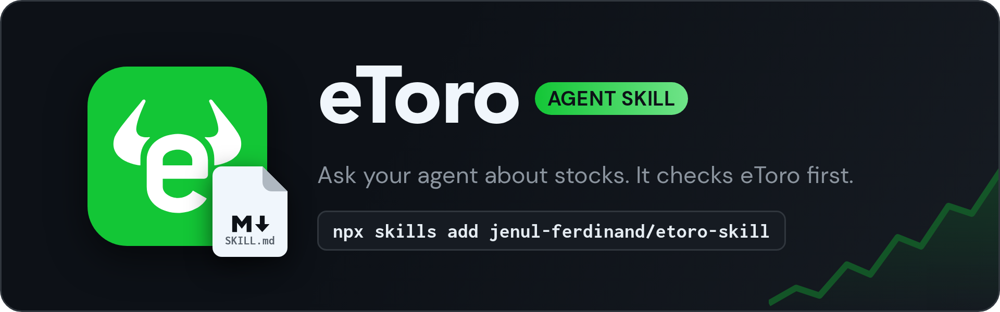

Ask your AI agent about your investments and it reads your live [eToro](https://www.etoro.com) account first: cash, equity, the 24h move, sector weights, and every holding by ticker with cost basis and P/L after fees and dividends, plus prices and trade history.

It's an [Agent Skill](https://agentskills.io), so it works with Claude Code, Codex, and any other agent that loads skills. It's read-only: `etoro.py` only sends GET requests to the [eToro public API](https://api-portal.etoro.com) and can't trade.

## Setup

1. Generate a public API key and a user key in eToro (your account must be verified). See the [API portal](https://api-portal.etoro.com/core/getting-started/authentication). Pick the Real environment and Read permission for the user key. `etoro.py` only sends GETs, but an agent with a shell could use the key directly, and a Read key makes eToro itself refuse trades.
2. Copy `.env.example` to `~/.config/etoro-skill/.env` and fill in the keys, or export `ETORO_API_KEY` and `ETORO_USER_KEY`. Keeping them outside the skill folder means updates don't wipe them.
3. Install the skill:
   ```sh
   npx skills add jenul-ferdinand/etoro-skill -g
   ```
   Or, in Claude Code, as a plugin:
   ```
   /plugin install etoro-skill --marketplace jenul-ferdinand/skills
   ```

## Usage

```sh
python3 etoro.py              # balance, equity, holdings by ticker
python3 etoro.py positions    # one row per lot
python3 etoro.py ids 1002     # instrument ID -> ticker
python3 etoro.py get /market-data/instruments/rates?instrumentIds=1002
python3 etoro.py --test       # self-check
```

Python 3.11+, standard library only. Unofficial and not affiliated with eToro. MIT licensed.
